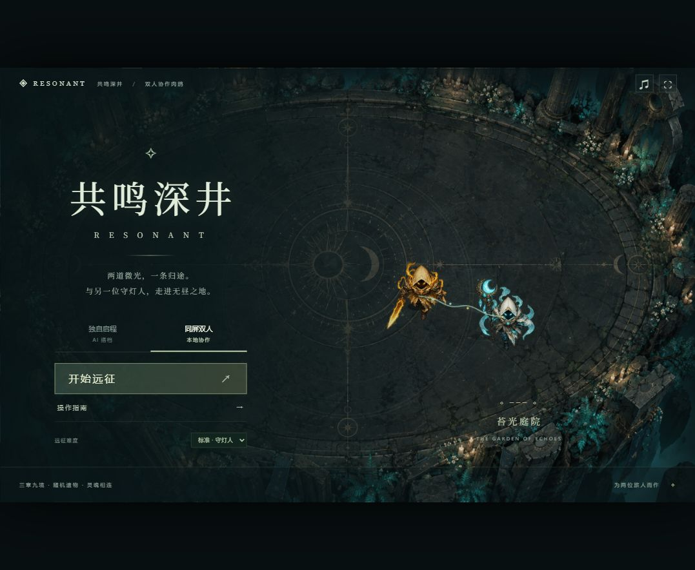

# 共鸣深井 · RESONANT

一款以「互相创造攻击机会」为核心的双人合作动作肉鸽。两位守灯人穿过三章九境，收集可叠加遗物，击败三位守护者，为深井带回黎明。

[在线试玩](https://yexiaotingonemt-jpg.github.io/resonant-depths/) · [GitHub 源码](https://github.com/yexiaotingonemt-jpg/resonant-depths)

在线版本直接在桌面浏览器中游玩，无需安装。支持 **不同电脑联网双人**、同屏双人和 AI 搭档。1.3 版加入四种开局契约和 20 件协作遗物，共 38 件遗物。同流派遗物的等级相加，达到 3 级、5 级就能解锁额外效果，也可以混搭其他流派。1.3.1 版重新整理了技能与遗物说明，先讲怎么配合，再列详细数值。战斗围绕挂印、破甲、引爆、搭档救援与双方确认合击展开。角色与怪物使用 FLARE 正式美术，支持八方向待机、跑步、挥击、施法、受击和倒地动画。推送到 `main` 后，GitHub Actions 自动执行测试、构建并更新 GitHub Pages。



## 开始游玩

### 不同电脑一起玩

1. 两人都打开上方「在线试玩」，选择 **联网双人**。
2. 房主点击 **创建房间**，将 `ABCD-EFGH` 格式的 8 位房间码或邀请链接分享给搭档。
3. 搭档输入房间码点击 **加入房间**，再点击 **我准备好了**。
4. 房主点击 **双人启程**，两人从三个随机契约中共同选择本局起点；任意一人确认即可同步给双方。
5. 两人各用 WASD / 方向键移动、Space 冲刺、E 技能、Q 共鸣合击，也可以使用各自的手柄。

每房间仅两人。双方都可暂停、选择遗物和路线；切换窗口会同步暂停。房主负责运行这一局，需保持页面开启。搭档断线后远征暂停，使用同一浏览器标签刷新后再次加入可恢复原位置、房间和构筑；房主关闭页面或离开则房间结束。无需注册或安装客户端。房间通过独立 WSS 中继连接，无需双方处于同一网络或配置端口转发。详见 [联网实现与部署](NETWORK.md)。

### 本地发行包

双击 `Start-Game.cmd`，浏览器会打开本地游戏。若初次打开时尚未连接，刷新一次即可。保留启动窗口，关闭窗口即可停止服务。

本机已安装 Node.js，发行包不需要安装 npm 依赖。服务仅监听 `127.0.0.1:5188`。

## 模式与操作

- **联网双人**：创建房间或通过房间码加入，房主是 P1，加入者是 P2。
- **同屏双人**：同一键盘，或最多两只标准映射手柄。
- **独自启程**：P1 由你操作，P2 是会走位、施法、释放合击和救援的 AI。
- **标准 / 轻松**：轻松模式所受伤害降为 65%，协作窗口也更宽松。

| 操作 | P1 烬 · 破阵者 | P2 澜 · 织灯者 |
| --- | --- | --- |
| 移动 | WASD | 方向键 |
| 冲刺 | Space | Shift |
| 主动技能 | E：范围攻击，打碎标记并吸引敌人 | Enter：引爆已破甲的敌人，给烬护盾、给自己回血 |
| 共鸣合击 | Q：发起 / 确认 | / 或数字键盘 0：发起 / 确认 |

手柄：左摇杆移动，A 冲刺，X 技能，Y 共鸣。Esc / P 暂停。切换窗口自动暂停。部分键盘有多键冲突，建议键盘与手柄混用。

### 一次完整的配合

1. **澜挂印**：远程自动攻击给敌人留下青色标记；先照顾烬正在接近的敌人。
2. **烬破甲**：靠近带青色标记的敌人，用自动攻击或 E 打碎标记，使敌人进入金色的破甲状态。E 还会吸引附近敌人来攻击自己，保护澜。
3. **澜引爆**：敌人破甲后，按技能键引爆：造成大量伤害，给烬护盾，同时给澜自己回血。对还没破甲的敌人使用技能，会先给他们加上标记。

重甲敌人和守护者会大幅减免未破甲伤害；猎手倾向追击澜。主动选择接敌位置、先标记再破甲、等破甲后再引爆，比两人各打各的更有效。烬优先攻击射程内带标记的敌人，远程优先协助前排；双方都保留自动攻击，操作重点是走位和技能时机。

**锁魂救援**：重甲敌人与首领会锁住其中一人，使其减速并开始倒计时。另一人命中施法者三次，或用技能命中一次，即可解救。被锁者无法用自己的攻击解除；击败施法者也能解除。错过窗口会受到伤害。

**双生共鸣**：破甲、引爆和解救积累共鸣。满 100 后，一人先按合击，另一人在 4 秒内确认，才会造成全场伤害并清除敌方弹幕。超时保留能量，需重新发起；AI 会回应玩家的合击。

魂链在相距 400 以内时减速穿过的敌人，单纯靠近不再造成伤害或积累能量。倒地后，存活搭档靠近 78 距离内停留 2.8 秒即可救援；两人都倒地则结束。

## 远征与构筑

三章分别为苔光庭院、沉星回廊、无昼圣所。每第三境为守护者战；其余房间分多波敌潮。

每局开场从四份契约中随机出现三份，选择一份后进入第一房。四条成长路线会改变技能时机与站位：

| 流派 | 配合方式 | 可组合的成长 |
| --- | --- | --- |
| 流火接力 | 两人先后用技能，先用的人冷却缩短，后用的人造成额外范围伤害 | 破甲和引爆缩短技能冷却、给搭档更多接招时间、配合后伤害提高 |
| 双生壁垒 | 澜给护盾，烬用盾挡伤害，再用技能把积攒的伤害打回去 | 扩大护盾、共享给澜、格挡反伤、引爆补盾 |
| 星涡织阵 | 烬把普通敌人拉近，澜引爆时顺带炸伤周围敌人 | 加宽魂链、技能减速、传播灵印、扩大技能半径 |
| 逆境守望 | 在残血搭档身边用技能，或救出被困搭档，获得短时间伤害加成 | 支援治疗、加快解救、致命保护、保护搭档时增伤 |

20 件流派遗物与 18 件通用遗物共同组成 38 件遗物池。清房后提供本契约方向、其他流派与通用强化的选择；选择不受契约限制。每拿到或升级一次流派遗物，该流派等级就加 1；达到 **3 级、5 级** 会自动解锁额外效果。其他流派也能这样升级。选遗物时会显示当前等级、升级上限，以及本次能否解锁新效果。满级遗物不再出现，四份起始契约互斥、仅在开局选择。

每局有 **2 次共享换牌机会**，清房时点击「换一批」替换三个选项；两人使用同一份次数。右下角构筑按钮可暂停并查看本局遗物、四条流派进度与完整图鉴。所有成长只在本次远征生效，重试同一种子会复现开局契约；之后的选择和换牌会影响后续随机结果。

中途可选择常规战场、星尘翻倍的精英试炼，或恢复生命的灵泉路线。

星尘用于本次远征与历史记录评分；不承担商店货币或永久强化功能。远征次数、通关数、最深房间及累计星尘保存在浏览器本地。结算可重试同一种子，复现随机波次及遗物序列。

## 开发

```powershell
npm.cmd install
npm.cmd run dev -- --port 5178
npm.cmd test
npm.cmd run build
node serve.mjs
```

Phaser + TypeScript + Vite。`src/sim.ts` 独立拥有规则状态，`scene.ts` 只负责呈现；`input.ts` 集中映射键盘和手柄，`audio.ts` 用 Web Audio 合成音效和环境音，`main.ts` 提供 DOM 菜单与 HUD。

自动测试覆盖契约起手、遗物等级上限、流派 3 / 5 级、四流派触发与混搭、换牌和过期选择，以及挂印—破甲—引爆、双向锁魂解救、护盾、合击确认/超时、战斗、种子复现、九房间流程、设备降级，以及联网输入验证、固定模拟时钟、过期指令、共享决策、房主权限、中继边界和八方向图集完整性。`npm run test:online` 使用 Chrome 的两个隔离浏览器端，验证真实中继建房/加入、准备、第三人拒绝、移动、技能、冲刺、暂停、倒地救援、真实弹道挂印、跨端破甲/引爆/护盾、锁魂解救、双方确认共鸣、遗物、路线、刷新重连和房主离开。`npm run test:growth` 验证随机契约、38 件图鉴筛选、升级预览、换牌、流派升级及较小桌面视窗的布局。`npm run test:art` 检查实际渲染器的八方向移动/待机、脚底锚点和动作切换并保存截图。浏览器测试先启动 5178 端口开发服务；可用 `RESONANT_TEST_URL` 指定其他地址。受控清敌和战斗夹具用于验证状态机，不代表真人平衡性测试；尚未用实体手柄验证。

`npm run test:balance` 使用相同移动与避弹控制器对比四种构筑；结果是可复现的模拟探针，不代表真人胜率。

另有 `node scripts/browser-devices.cjs` 的 Chromium 集成回归（运行前启动开发服务器 5178，安装 Chrome）：普通页面、真实 HTTP `Permissions-Policy: gamepad=()` iframe、音频 API 缺失和音频恢复被拒绝四种场景，均验证键盘位移、AI 更新、时间推进、暂停和恢复，无未捕获异常。音频 API 缺失和拒绝采用测试注入；手柄拒绝使用实际响应头，不模拟 API 返回。

正式角色与怪物来自 Flare 团队，按 CC BY-SA 3.0 提供；场景使用本项目原有 Image Gen 图像。完整来源、作者和加工说明见 [ART.md](ART.md)，原始致谢及许可随游戏发布。无需 API key。音效由本地合成，无外部音频请求。
